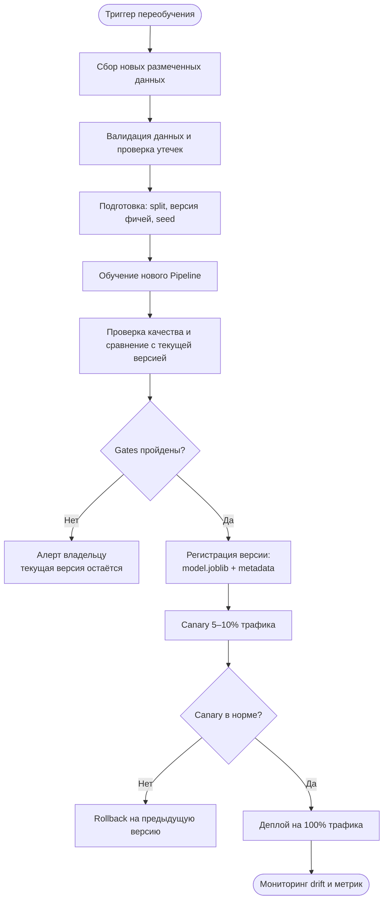

# Model Retrain BPMN — автоматическое переобучение

## 1. Схема процесса

## 2. Этапы: что происходит и что передаётся дальше

| Этап | Что происходит | Результат следующему шагу |
|---|---|---|
| 1. Триггер | Срабатывает расписание, PSI ≥ 0.2, падение recall ниже 0.90, новый источник данных или инцидент качества | Задача на переобучение с причиной, владельцем и сроком |
| 2. Сбор данных | Собираются новые размеченные случаи; проверяются схема, пропуски, дубли, утечки, согласие на использование | Валидированный датасет и `data_fingerprint` |
| 3. Подготовка | Train/validation split, фиксированный seed, версия признаков, проверка баланса классов | Обучающая и валидационная выборки, готовые к обучению |
| 4. Обучение | Fit Pipeline только на train; preprocessing внутри Pipeline | Кандидатная модель и отчёт обучения |
| 5. Проверка качества | ROC-AUC, recall, precision, F1, калибровка, подгруппы; сравнение с текущей версией | Отчёт с метриками и решением pass/fail |
| 6. Решение о публикации | Владелец модели и клинический lead сверяют gates и риск | Явное go / no-go с подписью |
| 7. Регистрация | Сохраняются `model.joblib`, `model_metadata.json`, версия, метрики, fingerprint | Версия в реестре моделей, готовая к деплою |
| 8. Деплой | Canary 5–10%, мониторинг latency, ошибок и метрик | Полный трафик или rollback |
| 9. Неуспех | При падении gates или canary — алерт, текущая версия остаётся, инцидент фиксируется | Инцидент-репорт и план исправления |

## 3. Что запускает переобучение

- плановое переобучение раз в квартал;
- PSI ≥ 0.2 по ключевым признакам;
- recall на размеченных данных < 0.90;
- новый источник данных или изменение популяции;
- инцидент качества или жалоба клинического lead.

## 4. Какие проверки проходит новая модель

| Gate | Порог |
|---|---|
| CV ROC-AUC | ≥ 0.90 |
| Test recall @ рабочего порога | ≥ 0.90 |
| Test precision @ рабочего порога | ≥ 0.70 |
| Разрыв recall по полу/возрасту | ≤ 0.05 |
| Калибровка | не хуже текущей версии |
| Schema / leakage tests | все проходят |
| Canary: latency p95 | ≤ 300 мс |
| Canary: доля ошибок | ≤ 1% |

Если хотя бы один gate не пройден, новая версия **не публикуется**.

## 5. Условия ввода в эксплуатацию

Новая версия попадает в production только если:

1. Все gates из таблицы выше пройдены.
2. Владелец модели и клинический lead дали явное go.
3. Версия и метрики зарегистрированы.
4. Canary 5–10% не показал деградации.
5. Rollback-план проверен.

## 6. Артефакты и rollback

- `model.joblib` — полный Pipeline;
- `model_metadata.json` — версия, дата, метрики, fingerprint данных, версии библиотек;
- предыдущая версия хранится минимум два релиза;
- rollback — переключение пути к модели и перезапуск API;
- инцидент фиксируется с причиной и владельцем.

## 7. Ответственные

| Этап | Владелец |
|---|---|
| Данные | Data engineer |
| Обучение | ML engineer |
| Оценка и gates | ML engineer + владелец продукта |
| Canary / rollback | MLOps / on-call |
| Клиническая приёмка | Врач-эксперт |
